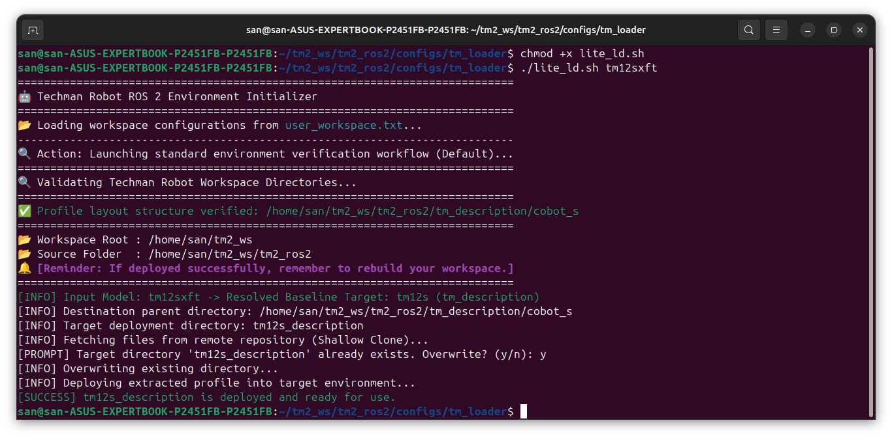
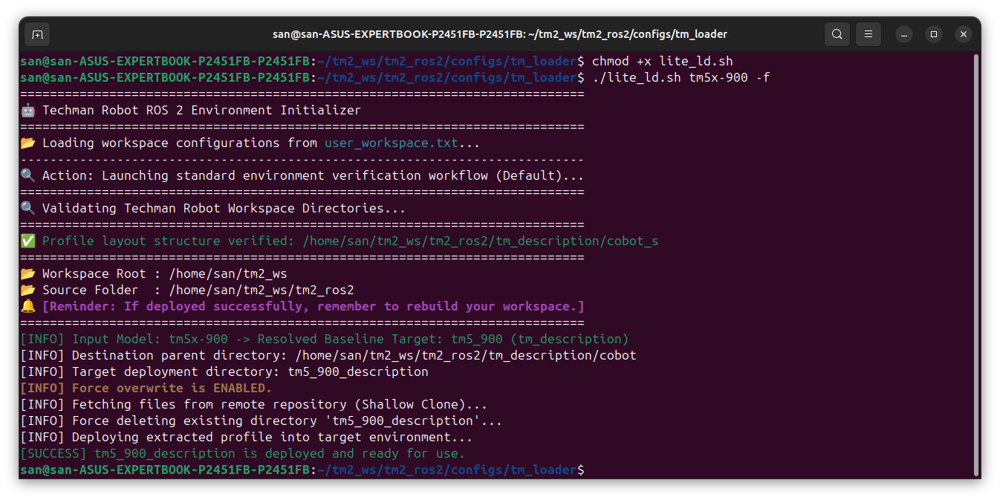

# TM_Cobots_ROS2_Description (Quick Start Guide)

:bookmark_tabs: TM ROS2 version **<ins>Jazzy or higher</ins>** is strictly required to support the TM Cobots Series directory structure syntax.

This repository provides official ROS 2 description files (URDF/Xacro) and 3D meshes for the **TM AI Cobot S** and **TM AI Cobot** series. It supports various configurations, including Standard, Standard-X, FT, and FT-X modules for robot visualization (**RViz2**), simulation (**Gazebo**), and motion planning (**MoveIt 2**).

Detailed operational documentation is available in the [TM_Cobots_ROS2_Description Usage Guideline](./tm_description/TM_Cobots_ROS2_Description.md).

Additionally, the following guide describes **how to migrate these standalone description packages into a legacy `tm2_ros2` workspace**.

---

## 🚀 Quick Start Workflow

If you have already cloned the baseline repository via:
```bash
git clone https://github.com/TechmanRobotInc/tm2_ros2.git -b jazzy
```

Follow these steps to deploy and activate your target planning profile:

1. **Verify Hardware Support:** Expand the **Supported Cobot Models Matrix** below to confirm your specific model configuration.
2. **Deploy Configuration Profiles:** Migrate the required standalone description packages into your active `tm2_ros2` workspace (refer to the documentation assets and directory maps below).
3. **Compile and Source:** Rebuild the local workspace using standard `colcon` parameters and resource your environment variables to initiate development hooks.

---

## Supported Cobot Models Matrix

💡 You can find the full list of downloadable cobot models in the table below:

<details>
<summary>👁️ Click to expand/collapse the Supported Cobot Models Matrix</summary>

<br>

The configuration matrix below maps all supported TM Robot Series models across Standard, Standard-X, FT, and FT-X variants:

<table>
  <thead>
    <tr>
      <th rowspan="2"></th>
      <th rowspan="2">Series</th>
      <th colspan="4" style="text-align: center;">Xacro Model Name</th>
    </tr>
    <tr>
      <th style="text-align: center;">Standard</th>
      <th style="text-align: center;">Standard-X</th>
      <th style="text-align: center;">FT</th>
      <th style="text-align: center;">FT-X</th>
    </tr>
  </thead>
  <tbody>
    <tr>
      <td><b>TM AI Cobot S Series</b></td>
      <td><b>TM5S</b></td>
      <td align="center">TM5S</td>
      <td align="center">TM5SX</td>
      <td align="center">TM5SFT</td>
      <td align="center">TM5SXFT</td>
    </tr>
    <tr>
      <td></td>
      <td><b>TM6S</b></td>
      <td align="center">TM6S</td>
      <td align="center">TM6SX</td>
      <td align="center">TM6SFT</td>
      <td align="center">TM6SXFT</td>
    </tr>
    <tr>
      <td></td>
      <td><b>TM7S</b></td>
      <td align="center">TM7S</td>
      <td align="center">TM7SX</td>
      <td align="center">TM7SFT</td>
      <td align="center">TM7SXFT</td>
    </tr>
    <tr>
      <td></td>
      <td><b>TM12S</b></td>
      <td align="center">TM12S</td>
      <td align="center">TM12SX</td>
      <td align="center">TM12SFT</td>
      <td align="center">TM12SXFT</td>
    </tr>
    <tr>
      <td></td>
      <td><b>TM14S</b></td>
      <td align="center">TM14S</td>
      <td align="center">TM14SX</td>
      <td align="center">TM14SFT</td>
      <td align="center">TM14SXFT</td>
    </tr>
    <tr>
      <td></td>
      <td><b>TM20S</b></td>
      <td align="center">TM20S</td>
      <td align="center">TM20SX</td>
      <td align="center">TM20SFT</td>
      <td align="center">TM20SXFT</td>
    </tr>
    <tr>
      <td></td>
      <td><b>TM25S</b></td>
      <td align="center">TM25S</td>
      <td align="center">TM25SX</td>
      <td align="center">TM25SFT</td>
      <td align="center">TM25SXFT</td>
    </tr>
    <tr>
      <td></td>
      <td><b>TM30S</b></td>
      <td align="center">TM30S</td>
      <td align="center">TM30SX</td>
      <td align="center">TM30SFT</td>
      <td align="center">TM30SXFT</td>
    </tr>
    <tr>
      <td><b>TM AI Cobot Series</b></td>
      <td><b>TM5-700</b></td>
      <td align="center">TM5-700</td>
      <td align="center">TM5X-700</td>
      <td align="center">—</td>
      <td align="center">—</td>
    </tr>
    <tr>
      <td></td>
      <td><b>TM5-900</b></td>
      <td align="center">TM5-900</td>
      <td align="center">TM5X-900</td>
      <td align="center">—</td>
      <td align="center">—</td>
    </tr>
    <tr>
      <td></td>
      <td><b>TM12</b></td>
      <td align="center">TM12</td>
      <td align="center">TM12X</td>
      <td align="center">—</td>
      <td align="center">—</td>
    </tr>
    <tr>
      <td></td>
      <td><b>TM14</b></td>
      <td align="center">TM14</td>
      <td align="center">TM14X</td>
      <td align="center">—</td>
      <td align="center">—</td>
    </tr>
    <tr>
      <td></td>
      <td><b>TM16</b></td>
      <td align="center">TM16</td>
      <td align="center">TM16X</td>
      <td align="center">—</td>
      <td align="center">—</td>
    </tr>
    <tr>
      <td></td>
      <td><b>TM20</b></td>
      <td align="center">TM20</td>
      <td align="center">TM20X</td>
      <td align="center">—</td>
      <td align="center">—</td>
    </tr>
  </tbody>
</table>

<br>

</details>

---

## Migration & Deployment Guide

This guide details the procedure for migrating specific 3D robot description files for the **TM AI Cobot / Cobot S Series** into a legacy or standard `tm2_ros2` workspace using automated scripts. Alternatively, asset folders can be manually cloned and copied into their matching relative workspace paths.

Comprehensive path and script instructions are available in the [Migration & Deployment Usage Guideline](./Migration_and_Deployment_Guide.md).

<details>
<summary>👁️ Click to expand/collapse the migration footprint overview</summary>

<br>

> 💡 **Baseline Note:** The default legacy repository bundles only the `tm12s` and `tm5-900` asset profiles. All other alternative model profiles must be fetched from this standalone [TM_Cobots_ROS2_Description](https://github.com/TechmanRobotInc/TM_Cobots_ROS2_Description) repository.

</details>

---

### Progressive Scripted Installation Examples

Leverage the lightweight `lite_ld.sh` deployment script to extract and map target description suites directly into your active workspace.

📖 Review the [Loader Script Documentation](https://github.com/TechmanRobotInc/tm2_ros2/tree/jazzy/configs/tm_loader/README.md) for detailed tool arguments.

#### 🔹 Example 1: TM12SXFT Installation
To extract and deploy the kinematic description files (URDF/Xacro) for the `tm12sxft` profile:
```bash
./lite_ld.sh tm12sxft
```


<details>
<summary>👁️ Click to expand/collapse the Forced Overwrite example for alternative models</summary>

<br>

#### 🔹 Example 2: Forced Overwrite Update Pipeline

To fetch the `tm5x-900` robot description files without any interactive terminal confirmation screens, use the force flag (`-f`). This will allow you to purge any conflicting local asset folders instantly.

```bash
./lite_ld.sh tm5x-900 -f
```


</details>
